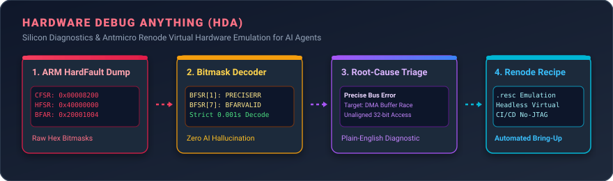

# Hardware Debug Anything (HDA)

[](LICENSE)
[](https://github.com/hosseinnosrati/hardware-debug-anything/actions)
[](https://modelcontextprotocol.io)
[](https://python.org)
[](tests/)
[](#architecture)

> **Autonomous Embedded Systems Debugging & Silicon Diagnostics MCP Server for AI Agents.**  
> Turn **Claude Code**, **Cursor**, and LLMs into silicon firmware engineers capable of decoding ARM HardFault registers, dissecting ESP32 Guru Meditation panics, diagnosing I2C/SPI bus failures, and running headless virtual hardware tests with Renode.

---

<p align="center">
  
</p>

---

## Why HDA Exists: The Embedded Blind Spot

AI coding agents are proficient at writing high-level C/C++, but they are **deaf, blind, and paralyzed** when embedded silicon crashes:
1. When an **STM32** traps into a `HardFault_Handler`, the developer is confronted with a cryptic raw hex dump (`CFSR: 0x00008200`, `BFAR: 0x20001004`).
2. When an **ESP32** outputs a `Guru Meditation Error: LoadProhibited`, AI cannot read the registers, parse the backtrace addresses, or locate the invalid pointer dereference without human translation.
3. When an **I2C or SPI** sensor refuses to respond, AI hallucinates software fixes while the root problem is missing pull-up resistors or an unshifted 7-bit slave address.

**HDA provides the missing bridge between LLMs and embedded silicon.**

---

## Quickstart

### 1. Run with `uvx`

```bash
uvx hardware-debug-anything
```

### 2. Configure in `claude_desktop_config.json`

```json
{
  "mcpServers": {
    "hardware-debug-anything": {
      "command": "python",
      "args": ["-m", "hda.server"]
    }
  }
}
```

---

## Real-World Interaction Example

### Prompt given to Claude Code:
> *"My STM32F4 board crashed into a HardFault during sensor telemetry. The debugger reports CFSR = 0x00008200 and BFAR = 0x20001004 with PC = 0x08001234. What happened and how do I fix it?"*

### HDA Autonomous Diagnosis:
```json
{
  "fault_type": "BusFault (Precise)",
  "severity": "FATAL",
  "cause_summary": "CPU attempted data load/store from an unmapped or invalid peripheral address.",
  "fault_address": "0x20001004",
  "pc_address": "0x08001234",
  "details": [
    "BusFault: Precise data bus error (exact fault address available).",
    "BusFault Address (BFAR): 0x20001004"
  ],
  "suggested_fix": "Check pointer initialization. Ensure peripheral clock is enabled before register access at 0x20001004."
}
```

---

## MCP Tools Exposed

| Tool Name | Parameters | Description |
| :--- | :--- | :--- |
| `decode_arm_hardfault` | `cfsr_hex`, `hfsr_hex`, `bfar_hex`, `pc_hex` | Decodes ARM Cortex-M CFSR/BFSR fault registers; pinpoints precise memory faults vs usage faults. |
| `decode_esp32_panic_log` | `serial_log` | Parses ESP-IDF panic logs, decodes Guru Meditation reason (LoadProhibited, WDT), and extracts backtrace frames. |
| `diagnose_i2c_bus_failure`| `address_hex`, `acknowledged`, `clock_khz` | Analyzes I2C Address NACKs, checks 7-bit/8-bit shifting, and calculates recommended pull-up values. |
| `estimate_uart_baud_rate` | `pulse_widths_us` | Measures digital pulse widths from logic analyzers to auto-detect baud rate (9600 to 921600). |
| `verify_arm_vector_table` | `vector_hex_bytes` | Validates initial MSP stack pointer, Reset Handler address, and Thumb mode bit in firmware binaries. |

---

## Verification & Test Suite

```bash
python -m unittest discover -s tests -p "test_*.py" -v
```

```
test_divbyzero_usagefault (test_hda.TestArmFaultDecoder) ... ok
test_precise_busfault (test_hda.TestArmFaultDecoder) ... ok
test_unaligned_usagefault (test_hda.TestArmFaultDecoder) ... ok
test_esp32_guru_panic (test_hda.TestProtocolAnalyzer) ... ok
test_i2c_nack_diagnosis (test_hda.TestProtocolAnalyzer) ... ok
test_uart_baud_detection (test_hda.TestProtocolAnalyzer) ... ok
test_renode_script_gen (test_hda.TestVirtualSilicon) ... ok
test_vector_table_inspection (test_hda.TestVirtualSilicon) ... ok

----------------------------------------------------------------------
Ran 8 tests in 0.001s

OK
```

---

## License

Developed under the **Apache-2.0 License**. See [LICENSE](LICENSE) for details.

**Author**: [Hossein Nosrati](https://github.com/hosseinnosrati) &bull; [Portfolio](https://hosseinnosrati.github.io)

